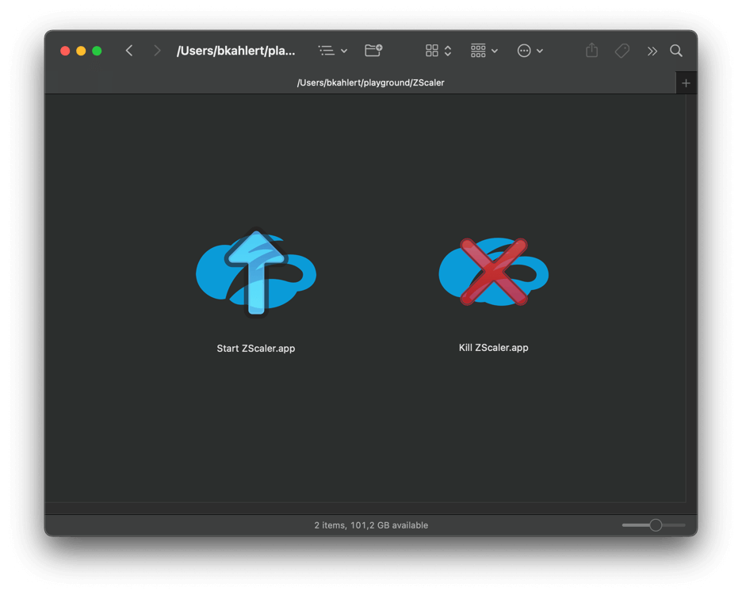

*Instructions on [how to share the connection of a Zscaler installed in a virtual machine](#sharing-zscaler) can be found below.*

# Killing Zscaler on macOS [![Build][build-badge]][build] [![License][license-badge]](LICENSE) [](https://www.buymeacoffee.com/bkahlert)

[build]: https://github.com/bkahlert/kill-zscaler/actions/workflows/test.yml
[build-badge]: https://img.shields.io/github/actions/workflow/status/bkahlert/kill-zscaler/test.yml?branch=main&label=Build&logo=github&logoColor=fff
[license-badge]: https://img.shields.io/github/license/bkahlert/kill-zscaler?color=29ABE2&label=License&logo=data%3Aimage%2Fsvg%2Bxml%3Bbase64%2CPHN2ZyB4bWxucz0iaHR0cDovL3d3dy53My5vcmcvMjAwMC9zdmciIHZpZXdCb3g9IjAgMCA1OTAgNTkwIiAgeG1sbnM6dj0iaHR0cHM6Ly92ZWN0YS5pby9uYW5vIj48cGF0aCBkPSJNMzI4LjcgMzk1LjhjNDAuMy0xNSA2MS40LTQzLjggNjEuNC05My40UzM0OC4zIDIwOSAyOTYgMjA4LjljLTU1LjEtLjEtOTYuOCA0My42LTk2LjEgOTMuNXMyNC40IDgzIDYyLjQgOTQuOUwxOTUgNTYzQzEwNC44IDUzOS43IDEzLjIgNDMzLjMgMTMuMiAzMDIuNCAxMy4yIDE0Ny4zIDEzNy44IDIxLjUgMjk0IDIxLjVzMjgyLjggMTI1LjcgMjgyLjggMjgwLjhjMCAxMzMtOTAuOCAyMzcuOS0xODIuOSAyNjEuMWwtNjUuMi0xNjcuNnoiIGZpbGw9IiNmZmYiIHN0cm9rZT0iI2ZmZiIgc3Ryb2tlLXdpZHRoPSIxOS4yMTIiIHN0cm9rZS1saW5lam9pbj0icm91bmQiLz48L3N2Zz4%3D

Zscaler can be annoying if you're trying to stop it. Despite having administrative rights, usually it asks for a password.

These commands stop Zscaler's launchd services for the current login session.
They require a logged-in desktop user and administrator authorization.
Starting restores the services and opens Zscaler as that desktop user.
Rebooting or logging in again may also restore services.

The fix for [#6](https://github.com/bkahlert/kill-zscaler/issues/6) uses
`launchctl bootout` and `bootstrap` with explicit domains:
`gui/<console-user-uid>` for LaunchAgents and `system` for LaunchDaemons.
It does not use legacy `load`/`unload`, kill individual processes, uninstall
anything, or change persistent service configuration.

**Limits:** Vendor self-protection, system/network extensions, and company
management software can prevent stopping or independently restart Zscaler.
These scripts do not bypass those mechanisms. Use them only where authorized.
See [verification and troubleshooting](#verification-and-troubleshooting) for
what the automated tests prove.

## Using the App

The apps delegate to the same shell scripts with a graphical administrator
authorization prompt.

- [Download this repository as an archive](https://github.com/bkahlert/kill-zscaler/archive/refs/heads/main.zip).
- Extract the **entire archive**. Keep both apps, the shell scripts, and
  [`zscaler.bash`](zscaler.bash) together; the apps are not standalone bundles.
- Open `Kill Zscaler.app` to stop Zscaler.
- Open `Start Zscaler.app` to restore it.

macOS may require approval before opening a downloaded, unsigned app.
The Terminal scripts below are an alternative. Authorization cancellation
and command failures are reported by AppleScript rather than treated as success.



## Using a Shell Script

- Open Terminal or whatever terminal you prefer (e.g. [iTerm2](https://iterm2.com/)).
- Type `git clone https://github.com/bkahlert/kill-zscaler.git`
- Type `cd kill-zscaler` to change into the newly cloned repository.
- Keep [kill-zscaler.sh](kill-zscaler.sh), [start-zscaler.sh](start-zscaler.sh),
  and [`zscaler.bash`](zscaler.bash) in that directory.

Stop Zscaler from the checkout:

```shell
./kill-zscaler.sh
```

Restore Zscaler from the checkout:

```shell
./start-zscaler.sh
```

Both commands request administrator privileges when needed. They also work
when invoked with `sudo`: the desktop user is resolved from `/dev/console`,
not the root account. Repeating either command is safe for services already
in the requested state. Failures return a nonzero exit status.

## Using a Shell

To invoke the scripts without executable permissions, run Bash explicitly
from the checkout. Stop:

```shell
bash ./kill-zscaler.sh
```

Start:

```shell
bash ./start-zscaler.sh
```

Use these shared entry points instead of copying launchctl one-liners.
They read each plist's `Label`, handle paths with spaces, and report errors.

### Using an Alias

The historical [kill-zscaler.alias.txt](kill-zscaler.alias.txt) file now defines
Bash/Zsh functions. They forward arguments and use the same scripts.
From the checkout, install them in the current shell, then stop and start:

```shell
export ZSCALER_REPO="$PWD"
source "$ZSCALER_REPO/kill-zscaler.alias.txt"
kill-zscaler
start-zscaler
```

For future shells, add an assignment of `ZSCALER_REPO` to the checkout's
**absolute path** and the `source` line to your shell initialization file
(`~/.bashrc` for Bash or `~/.zshrc` for Zsh). The functions then work from
any directory. Remove old `kill-zscaler`/`start-zscaler` aliases first.

## Verification and troubleshooting

[GitHub Actions](.github/workflows/test.yml) runs shell syntax checks,
ShellCheck, the existing connection-sharing regression, and
[lifecycle/documentation tests](tests/test_lifecycle.py).
The latter execute scripts, shell functions, app-wrapper delegation, and
the lifecycle commands above against controlled command doubles.
On macOS, they also compile the app wrappers' actual AppleScript.
Other shell blocks in this README are syntax-checked, not executed:
VM creation, SSH, and network configuration require a separate environment.

The workflow additionally runs [real launchd integration tests](tests/launchd-integration)
on disposable `macos-15` and `macos-26` runners.
They install harmless, uniquely labeled KeepAlive fixtures, exercise both
domains, check repeated stop/start and unrelated services, and clean up.
After stopping, they poll both service targets every five seconds for at least
600 seconds before restoring them. Any observed reappearance or inspection
error fails the test; a service returning between polls can escape detection.
These fixture jobs never install Zscaler. Linux containers cannot provide launchd.
The integration jobs refuse to run outside GitHub-hosted macOS CI.
Completed fixture checks cover Sonoma **14.8.9 (23J631)**, macOS
**15.7.9 (24G830)**, and **26.6.2 (25G83)**, each with at least
600 seconds of sampled absence before restoration.
Sonoma 14.0/14.6 remain unverified.
See the [run links and evidence boundaries](tests/README.md#completed-evidence).

For Sonoma coverage, manually dispatch the workflow with `sonoma` enabled
while `macos-14` remains available.
[GitHub is retiring Sonoma runners](https://github.com/actions/runner-images/issues/13518)
on November 2, 2026, with brownouts before removal.
It is therefore not a required target for every push.

The separate, manually dispatched `real_client` lane installs the pinned,
signed Zscaler **4.8.0.281** package only on disposable current-macOS runners.
It requires real running services before exercising stop, a 600-second
absence observation, restoration, repeated operations, and console-user app
ownership. Installation success alone cannot pass. No tenant is supplied.
The [completed actual-client run](tests/README.md#completed-evidence) passed
on arm64 macOS **15.7.9 (24G830)** and **26.6.2 (25G83)**.
Real vendor service/tray processes exited, all discovered launchd targets
remained absent for at least 600 sampled seconds, and services were restored.
Repeated stop/start, console-user tray ownership, and an unrelated service
also passed. Neither runner had an active system extension.

**Evidence boundary:** Regular green checks prove the fixture lifecycle.
Actual-client results are reported separately, including failed prerequisites.
Neither lane certifies enrolled network function, organization policy, native
authorization dialogs, or unsigned-app approval.
See the [evidence matrix and real-client prerequisites](tests/README.md)
for completed versions, reproduction, and remaining gaps.

Run the safe command-double suite locally from the checkout:

```shell
python3 -m unittest discover -s tests -p 'test_*.py' -v
```

If a command fails, retain its complete error output. Check that a desktop
user is logged in and that administrator authorization succeeded.
Discovery covers files or symlinks named `*zscaler*.plist` (case-insensitive)
directly in `/Library/LaunchAgents` and `/Library/LaunchDaemons`.
An absent service is a no-op; malformed plists, inaccessible domains, and
failed service operations are errors. Partial operations are not rolled back.
Do not treat a successful exit as proof that every Zscaler component stopped.
If Zscaler returns later, report the macOS/client versions, exact command,
error output, and whether device management or self-protection is enabled.

# Sharing Zscaler

To share an existing Zscaler VPN tunnel you can use [share-zscaler.v2.sh](share-zscaler.v2.sh) on the machine
with Zscaler installed as follows:
```shell
./share-zscaler.sh \
  --probe foo.bar.internal \
  --domain internal
```

- The script sets up network address translation (NAT) on the VPN client machine
  so that its VPN tunnel can be shared.
  - The `--prope` argument can be any hostname you want to connect to using the VPN tunnel.
    It's used to determine the connection details of your VPN connection.
  - The domains specified with one or more `--domain` arguments are used to
    customize the DNS name resolution on your host.
    This makes your host use your VPN client's name resolution for the specified domains (and sub-domains).
- It prints a configuration script that needs to be run on your host to make it use the just shared tunnel. 

If you prefer to have a one-liner without having to download anything you can use the following
command *at your own risk*:

```shell
bash -c "$(curl -so- https://raw.githubusercontent.com/bkahlert/kill-zscaler/main/share-zscaler.v2.sh)" -- \
  --probe foo.bar.internal \
  --domain internal
```

## Parallels macOS VM

If you only have a macOS client at hand you can set up a virtual macOS machine using [Parallels](https://www.parallels.com/pd/virtual-machines-for-mac).

1. [Install Parallels](https://www.parallels.com/products/desktop/trial/)
2. Set up a virtual machine
   1. The following scripts sets up a macOS machine with minimal footprint:
      ```shell
      declare -r PARALLELS=/Applications/Parallels\ Desktop.app
      declare -r VMDIR=$HOME/Parallels
      declare -r NAME=Zscaler
      curl -LfSo "$VMDIR/macOS.ipsw" "$("$PARALLELS"/Contents/MacOS/prl_macvm_create --getipswurl)"
      "$PARALLELS"/Contents/MacOS/prl_macvm_create "$VMDIR/macOS.ipsw" "$VMDIR/$NAME.macvm" --disksize 40000000000
      cat <<CONFIG >"$VMDIR/$NAME.macvm/config.ini"
      [Hardware]
      vCPU.Count=1
      Memory.Size=2147483648
      Display.Width=1920
      Display.Height=1080
      Display.DPI=96
      Sound.Enabled=0
      Network.Type=1
      CONFIG
      open "$VMDIR"
      open -a "$PARALLELS" "$VMDIR/$NAME.macvm"
      ```
      Take the chance to customize the above settings to your requirements.   
      **At the time of writing, the disk size cannot be altered later.**  
      40GB disk space (see `--disksize` argument) are recommended.  
      32GB disk space are the bare minimum.  
   3. Create a macOS user
   4. Install Parallels Tools and reboot
   5. Install Zscaler
   6. Login
3. Establish connection
   1. Start Zscaler (if not already running)
   2. [Run share-zscaler.sh](#sharing-zscaler)
4. Use connection
   1. On your local machine open a terminal
   2. Paste the host configuration script (that was printed in the previous step) in the terminal and run it

**You can now connect to all hosts you listed in step 2** 🎉

Optionally, you can set the name of your VM in
1. System Preferences → Network → Ethernet → Advanced... → WINS → NetBIOS Name
2. System Preferences → Sharing → Computer Name

## Remote Execution

This section describes the necessary steps to run `share-zscaler.v2.sh` on your
local machine instead of the virtual Zscaler machine using SSH.

### Preparation

#### On your virtual machine
1. Activate SSH by checking System Preferences → Sharing → Remote Login
2. Optionally extend your sudoers so that you may run `sysctl` and `pfctl` without having to enter your password:
   ```shell
   (
   echo "$(whoami) ALL=NOPASSWD: /usr/sbin/sysctl *"
   echo "$(whoami) ALL=NOPASSWD: /sbin/pfctl *"
   ) | sudo tee /etc/sudoers.d/zscaler
   ```
3. Optionally prepare a script with the following contents to lock your screen
   ```bash
   cat << 'LOCK_SCREEN' > ~/Desktop/lock-screen
   #!/bin/bash
   osascript -e 'tell application "System Events" to keystroke "q" using {command down,control down}'
   LOCK_SCREEN
   chmod +x ~/Desktop/lock-screen
   ```
   and run it on login via System Preferences → *Choose your user* → Login items → + → *Select your lock screen script*  
   Don't forget to make it executable using `chmod +x` and to run it once to provide it with sufficient permissions.
4. If the IP of your VPN client machine is dynamic and you can't reliably resolve its IP, a workaround can be to install [GeekTool](https://www.tynsoe.org/geektool/) and display the output of `ipconfig getifaddr en0` in a script Geeklet. At least you now find out the current IP easily.

#### On your local machine

1. [Create an SSH key](https://www.google.com/search?q=create+ssh+key+macos) or use an existing one
2. Copy the public key of your just created key pair to your Zscaler machine:
   ```shell
   ssh-copy-id -i ~/.ssh/id_rsa zscaler@Zscaler.local
   ```
   *This snippet assumes that your Zscaler host has the name `Zscaler` and your user account on that machine is `zscaler`.*
3. Check if you can log in:
   ```shell
   ssh zscaler@Zscaler.local printenv
   ```
   If the output shows the environment variables of your Zscaler host, all is fine.

### Execution

The following command needs to be run on your working machine,
which then connects to the host `Zscaler` with user `zscaler`,
and finishes configuring your working machine using the returned configuration Bash script:
```shell
(
  bash <<'SHARE_ZSCALER_V2'
ssh -4t zscaler@Zscaler.local '
bash -c "$(curl -so- https://raw.githubusercontent.com/bkahlert/kill-zscaler/main/share-zscaler.v2.sh)" -- \
  --probe foo.bar.internal \
  --domain internal
'
SHARE_ZSCALER_V2
) | bash
```

You get prompted for the password of user `zscaler` (unless you did the optional [sudoers configuration](#on-your-virtual-machine)).

> 💡 Users with a VPN host machine with dynamic IP can try to
change the `ssh` command to:
> ```shell
> ssh -4t "zscaler@$(sudo nmap -n -p 22 192.168.206.2-254 -oG - | awk '/Up$/{print $2}')"
> ```
> Be sure to change the `192.168.206` part to match the client's address range.
> The above `nmap` command looks for a machine with an open SSH port and pass the match to the `ssh` command. 

**Example output**:
```
No ALTQ support in kernel
ALTQ related functions disabled
pfctl: pf not enabled
No ALTQ support in kernel
ALTQ related functions disabled
rules cleared
nat cleared
dummynet cleared
0 tables deleted.
0 states cleared
source tracking entries cleared
pf: statistics cleared
pf: interface flags reset
pfctl: Use of -f option, could result in flushing of rules
present in the main ruleset added by the system at startup.
See /etc/pf.conf for further details.

No ALTQ support in kernel
ALTQ related functions disabled
pf enabled

   ▔▔▔▔▔▔▔ SHARE ZSCALER HOST CONFIGURATION

Configuring route to 10ß.200.0.0
route: writing to routing socket: not in table
delete net 100.200.0.0: not in table
add net 100.200.0.0: gateway 192.168.206.14
Configuring resolver for internal
Flushing DNS cache
Host configuration completed ✔
```


## Troubleshooting
- You can run the setup script as many times as you like.
- The output script to run on your local machine updates your name resolution accordingly,
  that is, it updates existing hosts and adds new ones.
- You will very likely have to update `SHARE_ZSCALER_SOURCE_ADDRESS` to the network used by your Parallels installation.
  - You can look it up by opening System Preferences → Network → Ethernet → IP Address
  - As an example: if the screen shows `192.168.42.3` you'll have to use `SHARE_ZSCALER_SOURCE_ADDRESS=192.168.42.0/24`
- If you happen to have no access anymore
  - check if Zscaler is actually connected
  - run (1) your customized `share-zscaler.sh` call on the VM and (2) its output script on your local machine again.
